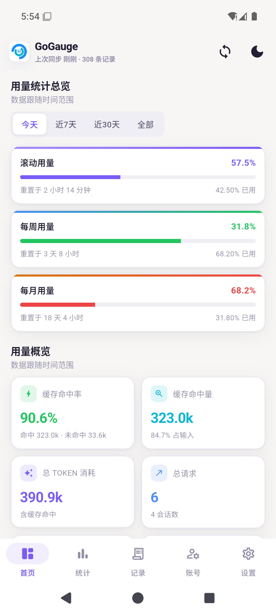
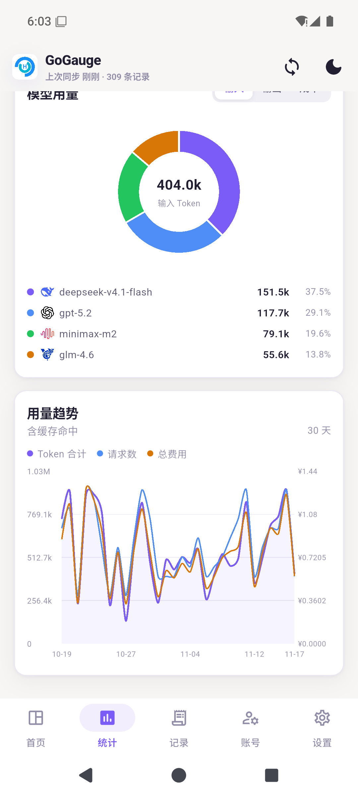
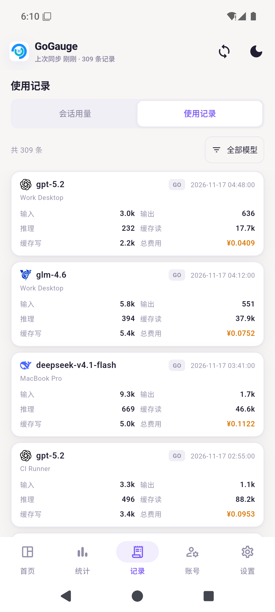
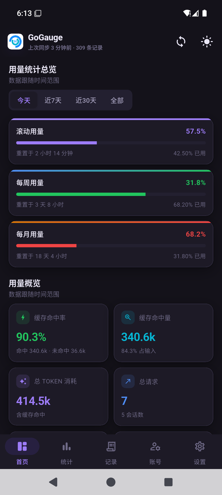

# GoGauge Mobile

OpenCode Go 用量面板的 Android 独立版，移植自 [yphyphyph/opencode-go-gauge](https://github.com/yphyphyph/opencode-go-gauge)（Windows 桌面版，MIT 协议）。

不依赖电脑：在 App 内登录 opencode.ai 后直接同步近 30 天用量明细，数据保存在手机本地 SQLite。桌面版保持原样，未做修改。

## 来源与声明 / Source & Attribution

本项目是 [GoGauge (opencode-go-gauge)](https://github.com/yphyphyph/opencode-go-gauge) 的 **Android / Flutter 移植版**，由社区维护，**不是上游作者发布的官方手机版**。

- 上游作者：yphyphyph
- 上游协议：MIT（见 [LICENSE](LICENSE)）
- 上游项目：<https://github.com/yphyphyph/opencode-go-gauge>
- 本仓库的改动：用 Flutter/Dart 重写界面；把上游 Python 的 API 客户端、配额解析、SQLite 聚合、增量/全量同步游标移植到 Dart；新增 Android 内置 WebView 登录、原生 CookieManager 桥、移动端底部导航、图表、深浅色与中英切换、Keystore 凭证存储。
- 上游的 Windows 桌面版是独立项目，本仓库不包含桌面版代码，上游仍在独立维护。
- 通用逻辑问题欢迎同时反馈给上游；移动端适配问题请在本仓库提 issue。

This is a community-maintained Flutter/Android port of GoGauge, not an official mobile release from the upstream author. The upstream Windows desktop application is a separate project and is not included here. See [NOTICE](NOTICE) and [LICENSE](LICENSE) for details.

| 首页 | 统计 |
| --- | --- |
|  |  |

| 记录 | 深色模式 |
| --- | --- |
|  |  |

## 功能

- 配额窗口：滚动 5 小时 / 每周 / 每月，进度条 + 剩余百分比 + 重置倒计时
- 用量概览：缓存命中率、缓存命中量、总 Token、请求数、费用（USD/CNY 实时汇率）、会话数
- 今日 24 小时输入/输出柱状图
- Token 构成：输入 / 输出 / 推理 / 缓存读 / 缓存写 / 会话数
- 模型用量环形图 + 排行，支持输入 / 输出 / 成本维度切换
- 30 天用量趋势（Token / 请求 / 费用双轴）
- 会话用量聚合（按 sessionID 分组，无 session 时按 key 拆分）
- 请求级使用记录，分页 + 模型筛选
- 多账号：添加 / 切换 / 重命名 / 重新登录 / 退出 / 删除
- 自动增量同步（1/5/15/30 分钟），同步范围（30/60/90/180 天 / 全部）
- 浅色 / 深色 / 跟随系统，中文 / English，CNY / USD
- 内置 WebView 登录 + 手动粘贴 Cookie 兜底
- 数据本地优先；会话 Cookie 存放在 Android Keystore 加密存储中

## 安装

仓库不提交 `build/` 产物；先从源码构建，APK 位于：

```
build/app/outputs/flutter-apk/app-release.apk
```

或使用 adb 安装：

```bash
adb install -r build/app/outputs/flutter-apk/app-release.apk
```

要求：Android 7.0+（以合并后的 minSdk 为准），无需电脑常驻。

## 登录

1. 打开 App，点「立即登录」；
2. 在内置 WebView 中完成 opencode.ai 控制台登录（Google / GitHub / 邮箱）；
3. 登录成功后会读取 `__Host-console_session` 并自动返回；
4. 首次登录会在后台全量同步最近约 30 天明细（服务端只保留 30 天）。

如果 WebView 登录无法完成（网络、2FA、风控等），使用「粘贴 Cookie 登录」：

1. 在电脑浏览器登录 <https://opencode.ai>；
2. 打开开发者工具 → Application/存储 → Cookies → `https://opencode.ai`；
3. 复制 `__Host-console_session` 的值；
4. 在 App 中粘贴 `__Host-console_session=st_...` 或直接粘贴 `st_...`。

> Cookie 等同于账号会话凭证，请勿分享。App 只把它用于请求 opencode.ai 官方接口。

## 从源码构建

环境：Flutter 3.47+、Dart 3.13+、JDK 17、Android SDK。

```bash
flutter pub get
flutter analyze
flutter test
flutter build apk --release
```

产物：`build/app/outputs/flutter-apk/app-release.apk`。

> 当前 `android/app/build.gradle.kts` 的 release 构建使用 debug 签名，方便个人安装。若要分发或上架，请配置自己的 keystore。

## 开发预览（演示数据）

不需要真实账号即可查看所有页面：

```bash
flutter run -t tool/preview.dart -d <device>
```

该入口会创建一个临时演示库（`gogauge_preview.db`），每次启动重新生成约 300 条模拟用量记录。

## 项目结构

```
lib/
  core/            主题色板、中英文案、格式化
  data/            opencode API 客户端、SQLite、同步、配额、汇率
  state/           AppState（ChangeNotifier）
  ui/              登录、底部 5 Tab、图表与通用组件
android/           MainActivity 中的 HttpOnly Cookie 原生桥
tool/preview.dart  仅开发用的演示数据入口
test/              API 解析、聚合口径、同步引擎测试
```

关键移植来源：

- `app/opencode_api.py` → `lib/data/opencode_api.dart`
- `app/db.py` → `lib/data/*_repository.dart`（增加 `created_ms` 列，避免依赖 SQLite 的时区解析）
- `app/server.py` 的同步算法 → `lib/data/sync_service.dart`
- `app/web/app.js` 的文案与交互 → `lib/core/i18n.dart` + `lib/ui/`
- `app/web/style.css` 色板 → `lib/core/theme.dart`

## 验证

- `flutter analyze`：无问题
- `flutter test`：24 项测试全部通过（Cookie 规范化、go/status 与 request-logs 解析、401、聚合口径、分页、去重、裁剪、增量游标、配额缓存）
- `flutter build apk --release`：构建成功
- 已在 Android 15 x86_64 模拟器上实测：登录页、WebView 打开 opencode.ai 登录页、首页/统计/记录/账号/设置/关于、深色模式、中英切换、模型筛选

## 已知限制

- 仅 Android；iOS 需要另建工程（WebView Cookie 读取需 WKHTTPCookieStore 适配）。
- App 被系统杀死后不会后台同步；目前是前台定时 + 回到前台补同步。桌面版的常驻托盘行为无法等价。
- 不导入桌面版 `data/gousage.db`；首次登录从官方 API 拉取近 30 天。
- 不做上游桌面版更新检查（手机端没有对应 Release）；关于页链接到上游 GitHub。
- 登录是最脆弱环节：opencode.ai 改登录页或 Cookie 策略时需要同步调整；粘贴 Cookie 兜底始终可用。
- 官方明细接口只保留 30 天，超过 30 天的数据只能依赖本机历史累积。

## 隐私

- 用量数据保存在本机 SQLite。
- 会话 Cookie 保存在 `flutter_secure_storage`（Android Keystore）。
- 除 opencode.ai 官方接口与汇率接口 `open.er-api.com` 外，不向任何第三方发送数据。
- App 已关闭 Android 自动备份（避免恢复后 Keystore 解密失败）。

## 致谢

- 上游项目：[yphyphyph/opencode-go-gauge](https://github.com/yphyphyph/opencode-go-gauge)（MIT）
- 数据与接口：<https://opencode.ai>
- 图表：[fl_chart](https://pub.dev/packages/fl_chart)
